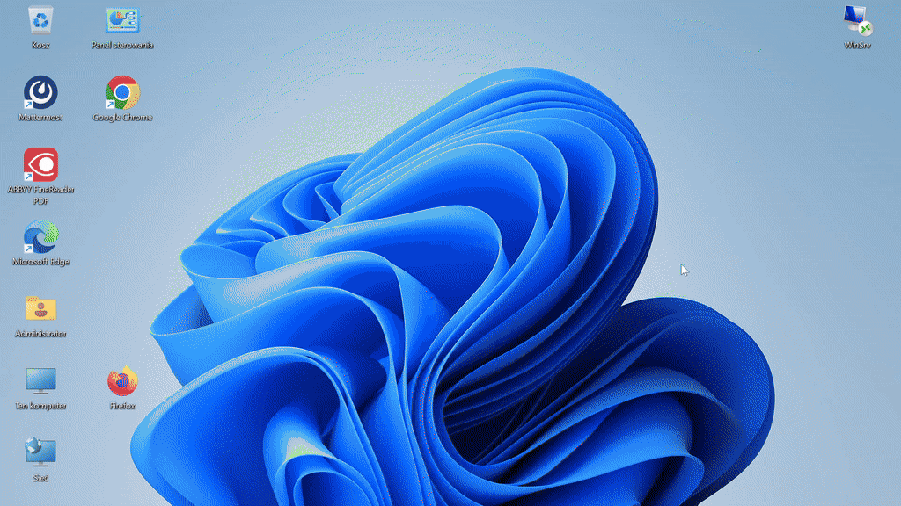
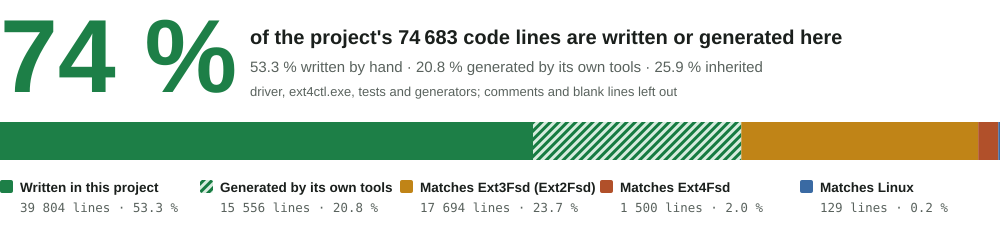
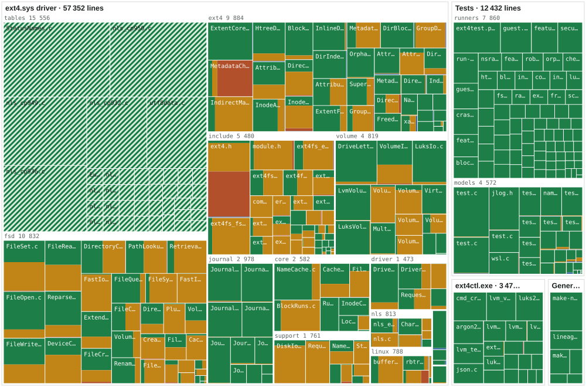
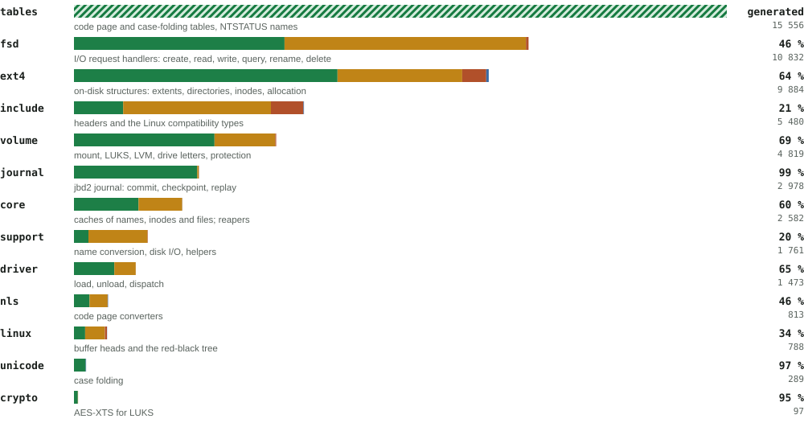
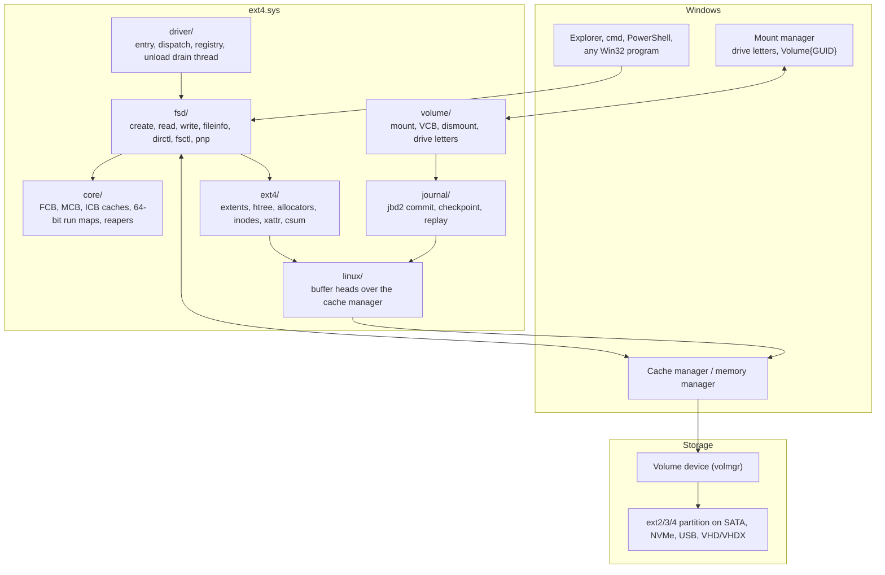
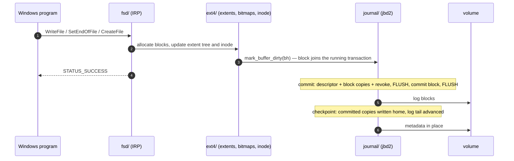
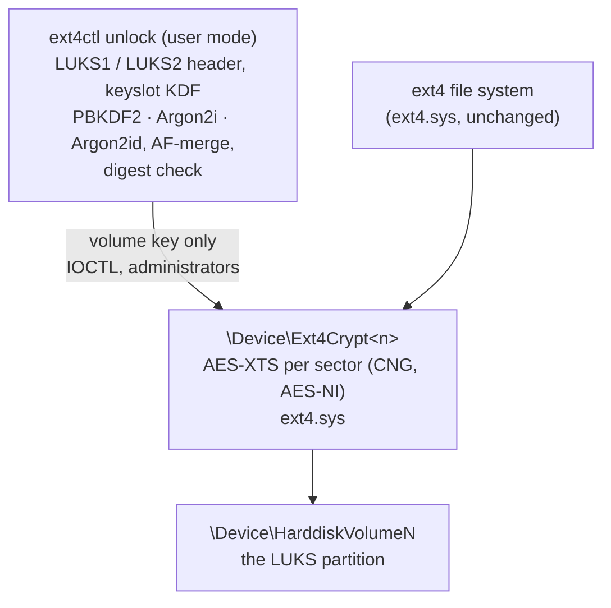
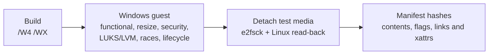

<div align="center">



[](https://youtu.be/TO6ssLvekVA)

[](https://github.com/wesmar/Ext4/releases/latest)

**[⬇ Download ext4.7z](https://github.com/wesmar/Ext4/releases/download/latest/ext4.7z)**
&nbsp;·&nbsp;
**[Source Code](https://github.com/wesmar/Ext4/archive/refs/heads/main.zip)**
&nbsp;·&nbsp;
**[All Releases](https://github.com/wesmar/Ext4/releases)**

> No archive password. Extract `ext4.sys` and `ext4ctl.exe`.

[](LICENSE.md)
[]()
[]()
[]()

</div>
> **Engineering status**
>
> `ext4.sys` provides native ext2/ext3/ext4 read/write access on bare-metal Windows systems and in virtual machines. Validation covers the full Windows/Linux matrix, dedicated ext2/ext3 checks, earlier 16 TiB boundary campaigns and production-code regression models. It also includes Driver Verifier and repeated unload testing. Metadata checksums are verified on read; corruption found on disk is recorded in the superblock and handled as the volume's `errors=` setting asks. Microsoft production signing is pending; loading uses KVC or DrvLoader on systems you administer. Keep a backup of important data.

> **Repository policy:** the release archive is not password-protected. Git tracks the active source, project files, tests and documentation. Build outputs, symbols, local tooling, virtual disks and test logs stay outside the repository. Test passphrase defaults in two PowerShell scripts are represented by `<TEST_LUKS_PASSPHRASE>`.

# Ext4 for Windows — Native ext2/ext3/ext4 Read/Write Driver

<br>

<div align="center">

**A drive letter for your Linux partition • journaled writes • controlled unload**

*jbd2 journal, extents with unwritten preallocation, htree directories, metadata checksums, wide physical block addressing*

*Windows writes checked from Linux: metadata consistency and byte-exact contents*

</div>

<!-- SCREENSHOTS / VIDEO — drop files into images/ and uncomment:


-->

> **`ext4.sys`** is a native Windows kernel-mode file system driver for ext2, ext3 and ext4 volumes. It registers with the I/O manager, cache manager and mount manager. An ext4 partition receives a drive letter, appears in Explorer and Disk Management, and supports normal Windows file operations: create, write, rename, map and delete. Metadata updates pass through a **jbd2 journal** that Linux can replay. Writes use **unwritten extents** with Linux-compatible on-disk semantics. The validation pipeline checks Windows-written files from Linux using **`e2fsck` and SHA-256**.
>
> The codebase retains parts of **Ext2Fsd** by Matt Wu, **Ext4Fsd** by Bo Branten and Linux ext4/jbd2. Their code, algorithms and licensing scope are identified in [Code Lineage and Redesign](#code-lineage-and-redesign), where a map of every file shows the measured result: 74 % of the project's code lines are written or generated in this project. The active Windows paths were then reorganized, rewritten and tested from Windows through to Linux media verification.

---

## Table of Contents

- [Overview](#overview)
- [Code Lineage and Redesign](#code-lineage-and-redesign)
- [Architecture](#architecture)
- [Physical Addressing and File Bounds](#physical-addressing-and-file-bounds)
- [Write Path and the Journal](#write-path-and-the-journal)
- [Unwritten Extents](#unwritten-extents)
- [Performance Engineering](#performance-engineering)
- [Stopping on Demand — `sc stop`](#stopping-on-demand--sc-stop)
- [Drive Letters for Linux Partitions](#drive-letters-for-linux-partitions)
- [Encrypted Volumes — LUKS](#encrypted-volumes--luks)
- [Security Boundaries](#security-boundaries)
- [Source Layout](#source-layout)
- [Testing and Validation](#testing-and-validation)
- [Supported Features](#supported-features)
- [Known Limitations](#known-limitations)
- [Installation](#installation)
- [Building from Source](#building-from-source)
- [License](#license)

---

## Overview

Windows has no native ext4 file-system driver. On dual-boot and larger multiboot systems, ext4 volumes used by Ubuntu, Qubes OS and other Linux installations appear without a drive letter or `\\?\Volume{...}` link. The same happens when an ext4 disk is attached over USB. Disk Management reports these volumes as unknown.

The ways of reaching an ext4 partition from Windows, and what each one costs:

| Way in | What it costs | Drive letter, every program works? |
|---|---|---|
| `wsl --mount` | a Linux VM, administrator rights, the whole disk handed to WSL | No — files are reached through `\\wsl.localhost` |
| Copy tools (read-only viewers) | one application | No — copy out only, no writes |
| Commercial drivers | a paid licence, closed source | Yes |
| Ext2Fsd / Ext4Fsd | one driver, open source | Yes — the base this driver grew from |
| **`ext4.sys`** | **one kernel driver, open source** | **Yes, journaled, `e2fsck`-clean, stops on demand** |

Design rules the code follows:

- **Independent media verification.** The full matrix detaches the test volume from Windows, checks it with `e2fsck` and uses the Linux kernel to verify the files listed in the test manifests with SHA-256.
- **Event-driven background work.** Reapers use deadlines and notifications; volume teardown is woken when references are released. Protocol timing, such as multi-mount protection, follows the on-disk protocol.
- **Never write what Linux would not.** A journal that cannot be opened mounts the volume read-only instead of writing unjournaled; a feature the driver does not implement refuses the mount or forces read-only.
- **Warning-free is the minimum.** `/W4 /WX /std:clatest` in both configurations: a warning is a build error.

---

## Code Lineage and Redesign

<picture>
  <source media="(prefers-color-scheme: dark)" srcset="assets/lineage/summary-dark.svg">
  
</picture>

<picture>
  <source media="(prefers-color-scheme: dark)" srcset="assets/lineage/files-dark.svg">
  
</picture>

Every code file of the driver, `ext4ctl.exe`, the tests and the generators, sized by its code lines and coloured by where they come from. Comments and blank lines are left out. `tools/lineage/lineage-svg.py` draws the three pictures from the measurement described below.

<details>
<summary><b>The driver by subsystem</b></summary>

<picture>
  <source media="(prefers-color-scheme: dark)" srcset="assets/lineage/subsystems-dark.svg">
  
</picture>

</details>

I developed the current Windows architecture around explicit object lifetimes, per-volume transaction ownership and bounded error handling. The active write, allocation, journal, mount, unload and security paths have been replaced or substantially rewritten, with modules organised by responsibility. I verify their behaviour with production-code models and Windows-to-Linux media checks. Mathematical precision guides this work: explicit invariants, bounded state transitions, clear ownership and measured hot paths.

The table below records retained components and their technical lineage. Attribution and licence notices remain with the source. I am continuing the rewrite toward self-contained, independently authored modules, with MIT licensing as a long-term goal for an independent implementation. Seven such modules are MIT-licensed so far. The case folding of casefolded directories, `src/unicode` - tables generated from the Unicode Character Database, the normalizer and their interface - is written from its specification and produces exactly the bytes Linux produces. The code page converters, `src/nls/CharsetMap.c`, the 37 `nls_<code page>.c` files and EUC-JP, are generated from the published Microsoft, ISO 8859, KOI8 and JIS X 0212 mapping tables in a representation of my own; the inherited converters serve only as the reference they are proven equal to. The red-black tree under the buffer heads, the run map and the htree reader, `src/linux/rbtree.c`, is written anew from its rules, each repair once for both mirror images, and checked against a sorted array. The journal's recovery side - the log format (`src/journal/JournalFormat.h`), the replay (`JournalReplay.c`) and the loading of a journal at mount (`JournalLoad.c`) - is written from the rules jbd2 follows, not from its code; the engine that writes the log uses the same format definitions. The orphan cleanup at mount, `src/ext4/Orphans.c`, is new. So are the directories - the name hashes, a directory's blocks and their hash index, the multiset of its caseless names (`NameHash.c`, `DirBlock.c`, `DirIndex.c`, `NameSet.c`) and their use in the driver - and the extent tree (`ExtentCore.c`, `ExtentFile.c`): each written from the rules of the format and proven against a model before the driver used it (see Testing). The current combined driver remains `GPL-2.0-only`.

How much of the code is new is measured, not estimated. Of the 258 366 C tokens written by hand - comments and the generated tables (code pages, case folding, NTSTATUS names) left out - **58.8 %** lie in no run of twelve tokens that also occurs in an origin. **37.2 %** still match Ext2Fsd as Matt Wu left it in Ext3Fsd; **3.7 %** match Ext4Fsd; **0.2 %** matches Linux v6.6 directly. Counted by code line, a line going to the origin of most of its tokens, the driver's hand-written code is 54.1 % new; with `ext4ctl.exe`, the tests and the generators, the project's 74 683 code lines are 53.3 % written by hand and 20.8 % generated by its own tools (the pictures above). The rewritten subsystems are 92-98 % new: the journal (98 %), case folding (97 %), the extent tree (96 %), the code pages (93 %) and the directory index (92 %); the block allocator is 88 % new, the unload 83 % and the name cache 81 %. The retained share sits mostly in the I/O request handlers (`src/fsd`, 30 % of it), the older on-disk code - metadata checksums, indirect blocks, group descriptors, inode storage (21 %) - and the headers (20 %). Exact runs count renamed code as new. A stricter count replaces every identifier, number and string by its kind and compares runs of twenty tokens, so that code which was only renamed counts as inherited too: by it the new share is 41.6 %. `tools/lineage/lineage.py` repeats the measurement.

| Source project | Attribution | Retained components and lineage |
|---|---|---|
| **Ext2Fsd** | Matt Wu, with KaHo Ng | The FCB/MCB model, fast I/O, the extent and htree routines Matt Wu ported from Linux, and much of the support code; ext2/ext3 lineage |
| **Ext4Fsd** | Bo Branten | ext4 structures, checksum and jbd2 lineage, Visual Studio project ancestry |
| **Linux kernel** — `fs/ext4`, `fs/jbd2`, `fs/nls` | Linus Torvalds, Stephen Tweedie, Red Hat, Cluster File Systems and the ext4 / jbd2 developers | Extent-tree, htree, checksum and journal algorithms; the code page registry, UTF-8 and the KOI8-RU adapter |
| **lwext4** | Grzegorz Kostka, KaHo Ng | The original extended-attribute implementation; its BSD notice remains in `ext4_xattr.h` |
| **Unicode Character Database 12.1.0** | Unicode, Inc. | Data of the case folding tables (`src/unicode/utf8data.c`), under the Unicode terms of use |
| **unicode.org MAPPINGS** — Microsoft code pages, ISO/IEC 8859, KOI8 | Microsoft Corporation, Unicode, Inc. | Data of the code page tables (`src/nls/nls_*.c`), under the Unicode terms of use |

What changed on the way to `ext4.sys`, in short:

- **Structure.** The monolithic source tree is divided by responsibility into `driver`, `fsd`, `volume`, `core`, `ext4`, `journal`, `linux`, `nls` and `support`. Each area has its own header; the former umbrella header had 3 400 lines. Before behavior changed, preprocessing proved the split token-identical across 1 615 functions.
- **Journal commits and recovery.** A Windows-native jbd2 commit engine logs every metadata change and commits it before the home write. Linux `e2fsck` or the driver replays an interrupted transaction at the next mount; the driver's replay follows jbd2's rules - revokes, the three checksum versions, stale blocks of an earlier round of the log, async commits - and leaves every block as `e2fsck` leaves it (`tests/journal-replay-wsl.sh`). New transaction IDs start past every ID the replay found in the log.
- **Orphans finished at mount.** A file deleted while it was open, or a truncation under way, sits on an orphan list when the system crashes. A writable mount finishes them as Linux and `e2fsck` do - from the classic list and from the `orphan_file` - cutting a file to its size or releasing an inode with no name left; a bad orphan is recorded as an error, an unsound orphan file keeps the volume read-only.
- **Stopping and unloading.** `sc stop` drains mounted volumes and outstanding references before releasing the driver.
- **Physical addressing.** Allocation, block I/O, extent caches and metadata tracking carry wide physical addresses. A driver-owned red-black run map replaces the Windows mapping interface that discarded the upper physical-block bits. Legacy on-disk pointers retain their specified width.
- **Journal ownership.** The journal engine belongs to the volume control block. Stopping its session and freeing the engine are separate steps, so a late stream close cannot enter a freed journal during teardown.
- **Character mappings.** The 37 code pages are generated from the published tables, with the differences the driver has always had kept as listed data, and stored as 32-entry slices: a constant, an ascending run, 32 pooled values, or an entry - a mask of exceptions and one of six kinds of member values. Two of them are the two directions of one structure: the GBK and UHC extensions, which fill in Unicode order the code points their base sets leave free, are a population count of members on the Unicode side (rank) and the position of a member in a bitmap on the code side (select), with no search. The CJK tables went from 423 KB to 277 KB to 201 KB; the case maps every code page carried - 18 KB the driver never read - are gone. The rebuilt converters fixed two inherited faults: KOI8-RU read every byte but the two it changes as `Ў` or `ў`, and Shift JIS wrote a Latin-1 character's two bytes past a bound of one. EUC-JP is written anew over code page 932, the table of its IBM extensions derived from the published CP932 and JIS X 0212 tables. Names are converted and folded at PASSIVE_LEVEL only, so the tables of every code page and of case folding live in a pageable section: 261 KB that no longer stay resident. A name is converted in one pass, not three. Conversion failure releases a directory entry once and returns no dangling pointer.
- **A 39 % smaller image, no feature dropped.** `ext4.sys` went from 987 KB to 598 KB in three steps: the code page maps compacted into 32-entry slices (819 KB), the case folding tables generated from the Unicode data and the code page directories indexed by byte (719 KB), the code page converters generated with rank and select slices and the unused case maps removed (598 KB). Lookups stay bounded and every step is proven equal to the code it replaced. The work since - the crash-state fixes, the faster listings, the new tree - brought the image to 600 KB.
- **Every crash state, checked.** A test build records each write and flush the driver sends to a volume; every prefix of that record - each state a power cut can leave - and every reordering of the writes between two flushes is replayed onto the volume as it was and judged by `e2fsck` (`tests/crash-vm.ps1`). It found the journal superblock moving the log's tail past checkpointed blocks before they were flushed: a disk persisting its cache out of order could keep the new tail and lose a directory block. Those writes are flushed first now, and the tail is published only when the log needs the room, as jbd2 does - which also took a superblock write and two device flushes off every fsync. A file whose flush returned must hold, in the state right after it, what it holds at the end. And the driver's own journal replay is held to the same states: a crash state the driver mounts must come out as `e2fsck` replays it, name for name and byte for byte (`tests/crash-recover-vm.ps1`).
- **Case folding.** Linux folds the names of a casefolded directory through a 64 KB trie walked over the bits of each UTF-8 sequence. That trie accepts exactly strict UTF-8, and only the newest Unicode version of it is ever used, so a strict decoder and four table lookups reach the same leaves: 29 KB of tables generated from the Unicode Character Database, every one of the 1 112 064 leaves equal to the kernel's. The normalizer is written anew from what Linux emits - including the byte order it produces for invalid input, which it hashes too - and folds a name about 2.5 times faster.
- **Only what is used.** Linux compatibility headers kept prototypes of functions the driver never had (mballoc, page cache, sysfs, ioctl) and a whole ext3 journal header; 3 500 such lines went, with the compiled driver unchanged byte for byte apart from one unused 64-byte variable.
- **Drive letters** for partitions the mount manager treats as hidden (MBR type `0x83`, GPT "Linux filesystem").
- **Dozens of fixes** found by the test suite: data exposure past a write into preallocated space, extents created one block at a time, a block allocator that started every file in group 0, registry buffer overruns, uninitialised return values, unload hangs, reapers polling on timers, extended attribute blocks written without their checksum, a Windows EA write that erased the Linux ACLs of the file, a folder's read-only attribute - Explorer and copy tools carry it along - taken for a permission that kept every new name out of the copied folder, a Linux symlink whose `/` separators were turned into `\` in the inode itself - written back to the disk the next time the link changed - while Windows followed it, reparse requests on a volume handle that read the volume as a file, a directory's blocks freed by its removal under a lookup still reading them - recorded as corruption on a sound volume - a full path kept per name, stale under a renamed directory and freed under its readers (a folder renamed while Explorer watched it), the directory attribute accepted for a file, which was then read as one, `HidingPrefix` / `HidingSuffix` settings compared with a volume's instead of given to it - so never in force - xattr blocks leaked on delete, lazily initialised block bitmaps that never reached the disk, and reference leaks - a refused open, a close cut short on a demoted symlink, a delete taken over by the wrong handle - that kept `sc stop` pending for ever, a drive letter asked for through `IOCTL_APP_MOUNT_POINT` written over the `G` of `\DosDevices\Global` - for `Q:` the link made was `\DosDevices\Qlobal\Z:` - and requests sent to the disk cancelled after 30 seconds, a write that completed all the same reported as failed.
- **Request handlers in steps.** Create, read, write, cleanup, set and query information, directory queries, rename and link, volume I/O and extended attributes run as short steps over explicit request state, instead of single functions several hundred lines long. The split exposed faults those functions had hidden: dropped errors (an inode save, a file expansion, a directory index walk, a cache flush), a 30-second I/O timeout that freed its context under requests still in flight, dirty volume ranges forgotten while an asynchronous write was still in flight, a volume label written into the superblock without its lock, directory listings that skipped the volume's last inode, and extended attributes changed on immutable files.

---

## Architecture



File data goes through the cache manager like any Windows file system: cached reads and writes are served from the system cache, paging I/O comes back to the driver, which maps file blocks to disk blocks through the extent tree (or the indirect block map on ext2/ext3). Metadata goes through Linux-style buffer heads, which are pinned views of the volume stream in the same cache, so every inode, bitmap, directory block and extent node has exactly one copy in memory.

---

## Physical Addressing and File Bounds

The former 2³²-block **volume** ceiling is removed. Physical block numbers remain wide through allocation, extent lookup, run caching, metadata tracking and device I/O. A file can therefore use blocks above the old boundary without their upper bits being lost. Sparse GPT test disks exercise that boundary with 1, 2 and 4 KiB blocks; the 4 KiB fixture is larger than 16 TiB.

Physical addresses and file-logical indexes have different jobs and different on-disk widths:

| Address domain | Contract |
|---|---|
| Driver physical-block arithmetic | 64-bit values; geometry and conversions to signed Windows byte offsets are checked before use |
| ext4 extent data and tree pointers | 48-bit physical addresses, as stored in the ext4 format |
| ext4 file-logical indexes | 32-bit indexes; the current mapper requires the exclusive logical end to fit, giving a per-file bound of `(2³² − 1) × block size` |
| ext2/ext3 indirect pointers | 32-bit physical pointers on disk; allocation is constrained below 2³² blocks even on an ext4 volume containing a legacy-mapped inode |

At 4 KiB, the current extent-mapped per-file bound is 16 TiB minus one block. It is independent of the volume's size. Indirect-mapped files also obey the capacity of their direct, single-, double- and triple-indirect trees. Oversized EOF, allocation and write requests fail before the file's contents or allocation are changed; negative sizes and overflowing ranges are rejected.

Changing the stored indirect pointers to 64 bits would create a different disk format. Compatibility instead requires checked arithmetic, explicit allocation bounds and narrowing only after a value has been proved representable. The layouts are documented in the [Linux kernel's inode block-mapping specification](https://www.kernel.org/doc/html/latest/filesystems/ext4/ifork.html).

`core/RunMap.c` owns the in-memory range map. It uses the shared red-black tree, merges compatible adjacent runs, validates overlaps before mutation and preserves the original map if a required split allocation fails. Lookup is O(log n); sequential enumeration walks the runs in O(n). Its model tests compile the production implementation, rather than a separate copy of the algorithm.

---

## Write Path and the Journal

Every metadata change passes through one hook, `mark_buffer_dirty`. On journaled volumes it attaches the block to the running jbd2 transaction of the calling thread. The volume stream itself will only write byte ranges the driver has registered as dirty, so the cache manager cannot flush a metadata page behind the journal's back: write-ahead ordering is enforced, not hoped for. Ext2 uses its specified non-journaled write path.



Rules the engine keeps, each one learned from a failure it caused:

1. **One hook for all metadata.** Directory blocks that were marked dirty directly used to bypass the journal; after a crash the inodes came back and the directory entries did not. Every site now goes through `mark_buffer_dirty`.
2. **A handle joins a transaction only if it still fits the log**, the rule jbd2's `start_this_handle` enforces; otherwise it asks for a commit and waits. Without it a fast writer filled the log and the commit aborted the journal.
3. **Superseded records retire without I/O.** A block logged again by a newer committed transaction is not written home from the older one, so a hot working set cannot pin the log.
4. **The journal superblock is written with its checksum**, between two device flushes (`JlogSetTail`) — otherwise `e2fsck` calls it corrupt and the next mount refuses it.
5. **A required journal must be usable.** An external, corrupt or unreplayable journal mounts the volume read-only. Ext2, whose format has no journal, remains writable through its non-journaled path.
6. **Lifetime follows ownership.** Stream teardown stops the journal session. The VCB retains the engine until stream, inode-map, buffer-head and group-cache teardown is complete; entering an IRP scope touches only thread-owned state.

7. **Freed file-data blocks wait for commit before reuse.** Per-group transaction overlays keep them unavailable to ordinary data allocation until the freeing transaction is committed on disk. Journaled metadata allocations have a separate path, protected by journal ownership and revoke rules. A space-pressure commit is requested outside active handles and group locks.
8. **Failure follows the operation.** Required inode, buffer, revoke and device-sync failures propagate to the caller. If a mutation can neither finish nor roll back, the transaction is abandoned and the volume becomes read-only.
9. **Corruption is recorded, as Linux records it.** A block that fails its checksum or its structural checks is refused before anything is written from it. The superblock then says the volume has errors (`e2fsck` checks it at the next boot), with the count and the first and last place found; the volume goes on or stops writing as its `errors=` setting asks (`tune2fs -e`). A group whose block or inode bitmap fails its check is left out of allocation for the rest of the mount, and blocks of a corrupt pointer are let go rather than freed. An inode whose blocks cannot all be released during deletion goes on the orphan list, which the next Linux mount or `e2fsck` empties. The superblock is written by a per-volume worker, never by the thread that found the damage: that thread may be a paging read, which cannot wait for I/O of its own. A volume that stopped writing on an error stays read-only until it is dismounted, as Linux refuses to remount an aborted file system read-write.
10. **The engine keeps no clock of its own.** A handle that cannot join, a commit waiting for handles to drain and the stop each wait on an event that the change letting them go on sets, under the lock they test it by. The journal thread sleeps until the next thing is due: the commit interval - counted from a transaction's first record, as jbd2 counts it - the idle checkpoint, a request, or the release of a buffer a checkpoint waits for. A commit that polled for handles used to give up after 30 seconds and abort the journal; on a slow disk that turned a sound volume read-only.

The full matrix includes a dedicated free-and-reuse regression, and `corrupt-vm.ps1` plants damage on purpose and checks from Linux what the driver did with it. Earlier crash-injection runs during metadata churn finished with clean Linux and driver replay. These checks cover specific scenarios; the remaining gaps are listed in [Known Limitations](#known-limitations).

---

## Unwritten Extents

Windows programs usually set the file size first and write the data afterwards — `CopyFile` does exactly that. On ext4 the size change allocates **unwritten extents**: the blocks are reserved and contiguous, but they read as zeros until data is written into them. The write then converts exactly the blocks it covers.

The tests exposed several faults in allocation, conversion and resize:

| Problem | Effect | Fix |
|---|---|---|
| A write into the middle of an unwritten extent splits it in three. The first split let its two unwritten halves merge straight back into one, and the second split then marked everything right of the write as initialized | Blocks never written became readable: **stale disk contents visible from Linux** past the end of a large write | The first split passes `EXT4_GET_BLOCKS_PRE_IO`, as Linux `ext4_split_extent` does; the left extent is looked up again before the second split; a split outside its extent now fails with `-EIO` instead of wrapping `ee_len` |
| A block-cache miss left the run length at one block | Every write converted one block at a time and every block became its own extent: **a 1 MB file had 258 extents, an 8 MB file 1 955 and a two-level tree** | The block mapper is asked for the whole rest of the I/O at once and stops at the extent boundary by itself; a converted run is merged with its initialized neighbours |
| `SetEndOfFile` wrote zeros over the whole extension of every file | A 256 MB `SetLength` wrote 256 MB of zeros before the real data | Unwritten extents already read as zeros; only the tail of the old last block is cleared, as Linux `ext4_block_truncate_page` does. ext2/ext3 files, which have no unwritten state, still get the full range zeroed |
| Shrink skipped block truncation after an earlier allocating write | Regrowth exposed initialized data beyond the new end of file | Size changes truncate under the exclusive file resources; cached and uncached regrowth preserve the prefix and zero the newly exposed tail |
| Extent insertion rollback used the encoded unwritten length | ENOSPC could free blocks outside the allocation | Rollback uses the allocator's exact block count; regressions check free space, file contents and Linux metadata consistency |
| A file grown into its own preallocation (allocation size first, then the end of file) had those unwritten blocks marked written | The file showed what the disk held before - a deleted file's data - from Windows and from Linux | Growth leaves unwritten blocks unwritten; only a write turns them written, and only the blocks it covers |
| A cut inside an unwritten extent kept the part before it with a plain length | The same exposure: the kept blocks read as the disk's old contents | The extent tree was rewritten (`ExtentCore.c`); a cut keeps the extent's kind |
| A write into a hole in front of a leaf's first extent counted the hole up to the second one | The new extent overlapped the first (`e2fsck`: out of order extents, wrong `i_blocks`) - any Windows write across a hole of a sparse file Linux made | The hole ends at the next mapped block, wherever it is; checked against a flat map of every block |

Checked from Linux with `debugfs`: a 20 MB file written at an unaligned offset into a preallocated range is now **one initialized extent** followed by the untouched unwritten tail, and every byte outside the written range reads as zero.

---

## Performance Engineering

The design reduces work per I/O and contention between independent files.

| Mechanism | Engineering effect |
|---|---|
| Extent conversion per I/O run, followed by merging | Keeps sequential data contiguous and bounds extent-tree growth |
| Driver-owned 64-bit red-black run map | O(log n) lookup, O(n) sequential traversal and merged contiguous mappings without physical-address truncation |
| Unwritten preallocation | Growing an extent-mapped file reserves blocks; only the initialized tail needs explicit zeroing |
| Allocation goals based on the inode's block group | Preserves locality and spreads allocations across the volume |
| Word-at-a-time block search over the bitmap and pending-free overlays | Finds contiguous runs while excluding file-data blocks whose freeing transaction has not committed |
| Sorted, merged volume-wide metadata ranges | O(log R) overlap checks protect reserved structures, including relocated `flex_bg` metadata |
| CPU-scaled lock stripes for names, blocks and inodes | Independent groups and directories can progress concurrently |
| Shared resources for ordinary opens and lookups | Exclusive ownership is reserved for namespace changes |
| Interlocked free-space totals, folded into the superblock at commit and flush | Removes a shared superblock update from each allocation |
| Reference-counted buffer heads with serialized last-reference handling | Frequent releases avoid a global exclusive lock while preserving lifetime |
| Bounded cache reaping, deadlines and release notifications | Reclamation follows pressure and actual teardown progress |
| Directory name sets alongside htree lookup | Avoids a full directory scan for each case-insensitive create |
| Hardware CRC32C selected by CPUID and a check vector | Accelerates metadata checksums with a table-based fallback |
| Code page converters generated as 32-entry slices | Bounded lookup with no search - rank on the Unicode side and select on the code side of the GBK and UHC extensions; 121 KB less resident data than the previous compact form, no writable mapping tables |
| Case folding by code point tables | A strict UTF-8 decode and four table lookups per character instead of a walk over every bit of its encoding; one pass per combining class only inside runs of marks |
| Journal-aware flush ordering | Preserves durability while avoiding redundant completed device flushes |
| Journal tail published only when the log needs the room | An append with fsync takes 1.16 ms instead of 1.78 (NTFS about 1.09 in the same guest): no superblock write and two flushes per commit |
| Names converted in one pass; an indexed listing's names kept in chunks; name-cache stripes as push locks | A directory listing takes 460 ns per entry instead of 801 (NTFS about 400 in the same guest) |
| Half-MD4 with its steps written out; cached names compared byte for byte before case folding; ASCII names converted without the code page | A profile of the listing showed the name hash, the kernel's case-insensitive compare and the converter at a third of its time; a listing now takes 410 ns per entry instead of 509 (NTFS 383; medians of three alternating runs in the same guest) |

The code page maps are 32-entry slices - constants, ascending runs, pooled values and six kinds of entries - read by one converter per code page family. CJK encoders return both bytes through one 16-bit lookup. The two directions are preserved independently, including duplicate and one-way mappings. Against the inherited flat arrays, a character costs about 2 ns instead of 1 in a single-byte code page and 4-7 ns in a CJK one (3.3 million conversions per measurement); ASCII stays on constant and ascending slices, and UTF-8 is unchanged. Mapping data is read-only and resident, with no lazy allocation or paging introduced.

Lock stripes use four stripes per logical processor across all processor groups, rounded up to a power of two and capped by the volume's group count. Stripes occupy separate cache lines. Workloads concentrated on one directory or block group remain a separate contention case.

For one specified holder among *T* concurrent holders choosing independently and uniformly among *S* stripes, the probability that it shares a stripe with another holder is bounded by min(1, (*T* − 1) / *S*). This is a per-holder bound, not the probability of any collision across all pairs. Benchmark workloads determine the actual contention. LUKS workers are bounded by CPU count and a fixed buffer-memory budget.

`tests/copybench.ps1` measures preallocated writes, streaming writes, copies and cached reads. Completed writes and copies are checked with SHA-256 outside the timed interval. `tests/fsbench.ps1` covers small-file operations, append-and-flush, random I/O and sequential I/O; uncached reads use aligned native buffers.

Comparisons use the same guest and storage backend, alternate the volume order and run with Driver Verifier disabled. Exact timings depend on the storage, cache state, CPU allocation and antivirus policy. Performance results are recorded alongside the tested build.

Same-guest comparisons found ext4 ahead in file creation, rename and deletion; NTFS led in enumeration and append-and-flush workloads. Random and sequential I/O varied by workload. Alternating the previous and wide-address builds preserved comparable warm-cache performance; the initial cold-to-warm timing shift was larger than the difference between the builds. These are workload-specific VM results, separate from the bare-metal copy demonstration above.

---

## Stopping on Demand — `sc stop`

A file system driver on Windows is not meant to be unloaded: `IoRegisterFileSystem` marks the driver object as a base file system driver, and the I/O manager refuses `DriverUnload` for such a driver as long as it owns any device object — reference counts of zero are not enough. `ext4.sys` stops anyway, on a bare `sc stop ext4` or `net stop ext4`, with volumes mounted and handles open:

1. A no-wake kernel timer probes the unload-pending flag of the control device; nothing else in NT signals that a stop was requested.
2. A **drain thread** takes over: it asks the driver to prepare for unload, which requires empty volume lists, completed VCB teardown and reclaimed replacement VPBs. It waits for release notifications. A bounded short recheck covers references still held by the I/O manager after close.
3. Mounted volumes are dismounted as their handles go: the journal is committed and stopped, caches purged, data sections force-closed, drive letters withdrawn at once so nothing shows the volume as RAW.
4. Replacement VPBs are reclaimed only after their reference and device state permit it. Original VPBs are restored with their original persistent state. The control devices are then deleted and the last reference is dropped on a system worker thread, which runs `DriverUnload`.

Lifecycle tests cover idle stops, open files and directory watchers, repeated `sc stop` / `net stop`, and drive-letter restoration after restart. A busy handle delays unload until its reference is released.

While a volume is still busy the drain thread says why, in the kernel debug output: the counts that gate the teardown, and every file and file object that has not been closed yet - which is how the last reference leaks were found. Without a debugger, each step of the stop leaves its number in the service's registry key (`UnloadStep`, and `UnloadWaitStatus` for the last wait); the test runner prints both when a stop does not finish.

To replace the driver, run `sc stop ext4`, wait for `STOPPED`, copy the new `ext4.sys`, then load it through KVC or DrvLoader. `sc start` also works when the image is accepted by the machine's Code Integrity policy.

---

## Drive Letters for Linux Partitions

The volume manager creates a volume device for every partition, but the mount manager hands out drive letters only to partition types it knows. An MBR type `0x83` or a GPT "Linux filesystem" partition is treated as hidden: no letter, no `\\?\Volume{...}` link, and nobody opens it, so no file system is ever asked to mount it.

`volume\DriveLetters.c` listens for both hidden-volume and mounted-device arrivals, including devices already present when the driver loads. It opens each device once so the I/O manager asks the registered file systems to mount it. During reload, Mount Manager may remember `D:` after the live DOS link has gone. The worker restores that link before the open, breaking the wait between a missing path and an unmounted file system. After a successful mount, the driver registers the mounted-device interface on the volume PDO. Mount Manager then creates the `Volume{GUID}` link, restores its recorded letter and removes both when the device leaves. A new volume receives the first free letter from `D:`. `mountvol` and Disk Management see the same assignments.

Hot-plug tests with an open handle withdrew the letters on removal and restored them after replug. Timing depends on the storage stack and outstanding references.

---

## Encrypted Volumes — LUKS

LUKS (dm-crypt) is used by encrypted Fedora, Ubuntu and Debian installations, as well as Qubes OS. `ext4.sys` separates user-mode key derivation from the kernel-mode encrypted device:



- **The passphrase never enters the kernel.** `ext4ctl` derives the keyslot key in user mode — Argon2 may ask for a gigabyte of memory, which has no place in a driver — decrypts and merges the key material and checks it against the header's digest. Only the verified volume key goes to the driver, which keeps nothing but the key schedule; `ext4ctl lock`, `sc stop` and shutdown destroy it.
- **The driver adds a disk device of its own** over the encrypted segment. Every sector is AES-XTS with the plain64 tweak, exactly as dm-crypt; the file system mounts on that device like on any partition and knows nothing about encryption. The mount manager is told about the device directly — it has no PnP node — and gives it a drive letter and a `\\?\Volume{...}` name; the LUKS UUID is its unique id.
- **Writes** are never encrypted in place — the caller's pages are the cache. An aligned write is encrypted in the caller's own thread straight into a buffer of its own (the first XTS whitening pass is the copy) and sent on without waiting; the disk's completion finishes it, with no thread switch on the way. **Reads** go to worker threads that read into the caller's pages and decrypt them there; long requests are cut into pieces the threads take in parallel. The workers' buffers are allocated up front, so a paging write always makes progress. LUKS2 sectors of 4 KiB are presented as 512e: a part of a sector is read, merged and rewritten under a lock.
- **Formats:** LUKS1 and LUKS2 (both header copies and their checksums), `aes-xts-plain64` with 256- or 512-bit keys, PBKDF2 (SHA-1 … SHA-512), Argon2i and Argon2id computed with one thread per lane. The KDF, AES-XTS and PBKDF2 code is checked against the RFC 9106, IEEE 1619 and RFC 6070 vectors (`ext4ctl selftest`).

```cmd
ext4ctl list                                    :: partitions: LUKS headers and ext file systems
ext4ctl unlock UUID=bfba416e-... --letter G     :: asks for the passphrase, mounts as G:
ext4ctl unlock 7 --key-file C:\keys\data.key    :: the whole file is the passphrase, as in cryptsetup
ext4ctl status                                  :: what is unlocked, where
ext4ctl lock G:                                 :: dismount, drop the key (--force with open files)
```

`ext4ctl` is a single executable with no runtime dependencies; it works the same over ssh and on Windows Server Core. A partition is named by its number, its NT device name or the UUID of its LUKS header, which unlike the volume number does not change when disks come and go.

The LUKS tests use cryptsetup-created containers, including Argon2id parameters used by Qubes OS and 4 KiB encryption sectors. Windows writes are checked by Linux after locking the containers: file hashes must match and `e2fsck` must report clean metadata.

### LVM inside LUKS — read-only

Qubes OS, and many a Fedora install, put an LVM volume group inside the LUKS container: in Qubes a thin pool holding dom0's root and the private volume of every qube. `ext4ctl lv` maps the logical volumes of an unlocked container as disk devices of their own, **read-only**:

- `ext4ctl` reads the PV label and the current copy of the volume group's text metadata, and turns a volume into a table of runs over the LUKS device. A linear volume is its segments; a thin volume is looked up in dm-thin's own metadata — the pool's superblock, the btree of devices, the btree of block mappings — with contiguous chunks merged and chunks never written left as holes that read as zeros. Thin snapshots are thin volumes of their own and open the same way.
- The driver checks the table (it starts at 0, has no gaps, is sector-aligned and stays inside the LUKS device) and serves reads straight from it, split along the runs and sent on to the LUKS device without waiting. Writes fail and the device reports itself write-protected, so ext4 mounts read-only.
- **Why read-only:** a write to a thin volume may need a new chunk from the pool, which means changing the pool's metadata — the space maps and btrees that Linux's dm-thin owns and checks at the next boot. Reading changes nothing in LVM or dm-thin; the Linux side stays exactly as it was.

```cmd
ext4ctl unlock UUID=0061a882-... --read-only    :: the container itself: no file system on it
ext4ctl lv list 0                               :: the volume group inside \Device\Ext4Crypt0
ext4ctl lv open 0 qubes_dom0/vm-work-private --letter W
ext4ctl lv close W:                             :: or: ext4ctl lock 0 --force closes both
```

Tested on the LVM partition of the test disk, made by LVM in Linux (a linear volume, and a thin volume in a pool with 64 KiB chunks): every file byte-exact against Linux's manifest, writes refused, the container refuses to lock while a volume is open (`--force` closes the volumes first), `sc stop` with the volumes mounted, and `e2fsck -f` in Linux clean afterwards.

---

## Security Boundaries

A file system driver runs every request of every process in kernel mode, so each input a caller controls is checked before it is used:

| Entry point | Rule |
|---|---|
| Control device `\\.\ext4` | Created with a SYSTEM + Administrators ACL; a standard user cannot open it |
| Private IOCTLs (volume settings, mount points, statistics) | Kernel callers or administrators only; buffers shorter than their header are refused before a byte is read; strings from the caller are bounded and terminated by the driver |
| Unload request | Kernel mode only — the service control manager's stop path, never a user program |
| `FSCTL_GET_RETRIEVAL_POINTERS` | Raw user pointers (METHOD_NEITHER): probed, and every store into them guarded, so a buffer unmapped by another thread ends the request, not the system |
| Reparse point requests (`FSCTL_GET/SET/DELETE_REPARSE_POINT`) | A file or directory handle only - the control device and a volume handle are refused before anything is read through them. Set and delete as NTFS checks them (a writable volume, a handle granted write access to the data or the attributes) and as Linux does (the mode bits, `chattr +i`/`+a` on the file and its directory); names checked against the declared data; a symlink needs `SeCreateSymbolicLinkPrivilege`. A link replaces only another link, an empty file or an empty directory - no data and no directory entry is thrown away for it |
| Volume lock, unlock, dismount, extended DASD I/O | Taken from a handle to the volume only - opened for its data, it passed the volume device's ACL; through a file handle any user could have locked or dismounted the volume |
| Oplock requests | Granted only on counts read under the volume and file locks; one that cannot be decided at once is not granted |
| Set information | The buffer holds the class's fixed part, and a rename or a link its whole name - checked by the driver as well, for requests another driver builds without the I/O manager's checks |
| Extended attribute queries | A file or directory handle only - the control device and a volume handle are refused before their FsContext is used; the name list is validated entry by entry before it is walked |
| LUKS unlock and lock | Control device only, administrators only; the request is checked field by field, the key in the request buffer is wiped before the answer is copied back, the plaintext of written data is wiped from the bounce buffers. The decrypted disk device is open to SYSTEM and administrators only; files on it are the file system's to check |

`tests\security.ps1` proves each rule as an administrator and as a standard user (a restricted token of the test thread).

---

## Source Layout

One responsibility per folder, one header per folder, `/W4 /WX` clean.

```
Ext4/
├── src/
│   ├── driver/        # DriverEntry, IRP dispatch and work queue, registry, unload drain thread
│   ├── fsd/           # IRP handlers split by responsibility: create, read, write, cleanup, close,
│   │                  # fileinfo, dirctl, fsctl, lock, ea, reparse, pnp, fast I/O ...
│   ├── volume/        # Mount and verify, VCB, dismount, volume lock, drive letters,
│   │                  # LUKS disk devices (LuksVolume.c), LVM volumes inside them (LvmVolume.c)
│   ├── crypto/        # AES-XTS over CNG, shared by the driver and ext4ctl
│   ├── unicode/       # Casefolded directories: Unicode 12.1 case folding tables, normalizer
│   ├── core/          # FCB/CCB, MCB name cache, ICB inode table, 64-bit run maps, reapers
│   ├── ext4/          # Extent tree, htree, directory entries, block and inode allocators,
│   │                  # group descriptors, superblock, xattr, metadata checksums,
│   │                  # ext2/ext3 indirect block maps
│   ├── journal/       # jbd2: commit, checkpoint, log space, per-thread handles, replay
│   ├── linux/         # Buffer heads over the cache manager, kernel services, rbtree
│   ├── nls/           # Code page converters generated from the published tables (DOS, Windows,
│   │                  # ISO 8859, KOI8, CJK) and their shared lookup; registry, UTF-8
│   ├── support/       # Disk I/O, pool, name conversion, errno ↔ NTSTATUS, time, debug
│   ├── include/       # Area headers, checked file bounds, run-map contract; linux/ compatibility
│   ├── ext4.vcxproj   # WDK kernel-mode driver project
│   └── ext4.rc        # Version resource, generated from include/version.h
├── tools/ext4ctl/     # LUKS unlock and driver control: LUKS1/2, Argon2, BLAKE2b, JSON,
│                      # LVM metadata and dm-thin mappings
├── tools/lineage/     # Share of new code: token runs shared with Ext2Fsd, Ext4Fsd and Linux
├── tools/nls/         # Code page converters generator, the differences kept from the inherited maps
├── tools/unicode/     # Generator of the case folding tables from the Unicode Character Database
├── tests/             # Guest and host test scripts (see Testing and Validation)
├── build.ps1          # Finds VS and the WDK by evidence, builds bin\ext4.sys and bin\ext4ctl.exe
└── ext4.slnx
```

The driver and control tool are split by responsibility. LUKS header formats, keyslots, metadata parsing, LVM mappings, passphrase handling and driver control have separate modules; on-disk layouts have compile-time offset checks.

`FreedBlocks.c` owns transaction-bound block-reuse protection. `MetadataMap.c` builds the volume-wide system-zone map, including relocated `flex_bg` bitmaps and inode tables. `BlockSearch.h` contains the word-at-a-time bitmap search shared with its independent host model. Ext2/ext3 truncation is isolated in `IndirectTruncate.c`.

---

## Testing and Validation

The current Release and Debug builds are warning-free under `/W4 /WX`. With Driver Verifier enabled, the current Release image passed the full Windows/Linux matrix: **20 sections**, including **480 shrink/regrow cases** across plain and LUKS2 volumes, whole folder trees copied by robocopy, xcopy and .NET, transaction-bound free/reuse checks, LUKS1/LUKS2, read-only LVM and Linux feature interoperability with casefolded directories checked by `e2fsck`. All 37 code pages and KOI8-RU passed on a live volume: **38 code pages, 1206 filenames**. Rejected mounts and failed operations remain distinct outcomes of the malformed-media campaign. Fixture preparation, host models and targeted regressions run separately.

The crash-state campaign replays every prefix of a run's writes and, for every epoch between two flushes, every loss of one of its writes: **509 states** for the mixed workload and **2 725** for 300 flushed create/rename/delete rounds that wrap a 4 MB journal several times - all accepted by `e2fsck` after the journal replay, and in each run the whole record applied equals the volume the driver left. Before the tail fix, 10 of 509 states of the mixed workload lost a directory block. Further runs cover ext3 (**3 325 states**), ext4 with 1 KiB blocks (**3 196**), a directory grown to 2 000 names (**5 347**) and 300 churn rounds (**3 386**), none rejected; in the last two, recorded by the final build, **121 of 121** files that were the same at the end held, right after their last flush, what they hold there. A commit block written through is on the media when the write completes, so the reordering never loses it behind writes sent after that; without the mark, a run counted that impossible state as a failure.

The driver's own journal replay was then held to **120 of those states** - picked around commit blocks and spread over the runs, on ext3, 1 KiB blocks, the large directory and the churn run; 39 of the churn run's 40 needed a replay of up to 150 transactions. Mounted by the driver and unloaded, every one was clean for `e2fsck -fn` and held exactly the names and bytes `e2fsck`'s own replay of the same state holds.

The replay is now new code, written from jbd2's rules (`JournalReplay.c`), and tested on its own first. A model generates logs whose outcome follows from what was written: every feature set (none, 64-bit, checksum v1 with and without async commit, v2, v3), every kind of damage - a torn transaction, a bad or a stale commit, descriptor or revoke block, a data block that fails its tag, an unknown block, a transaction of another journal, a revoke block that claims too much - at every transaction of small logs, starts at the ring's wrap and IDs at the 2^32 wrap, then random logs. Each case checks the error, the end of the log, the failed commit, every home block, every allocation failing in turn and leaks: **70 888 cases, 838 888 checks**, on x64 and on x86. Of 28 faults planted in the code on purpose, 24 fail the model; the four that pass change nothing any log can show. The same logs, written into the journal of real ext4 volumes with 1 KiB and 4 KiB blocks, were replayed by `e2fsck` and by the driver's code: **5 950 cases, no difference** in the home blocks, the checksum errors or the corrupt commits reported. In the driver, the new replay passed the 120 crash states again, and a new 3 384-state churn run recorded by the new engine passed with it.

Orphans finished at mount (`tests/orphan-vm.ps1`): 18 volumes - the kernel's own orphans (files deleted while open) in the orphan file and on the classic list, after a crash with the journal to replay and while frozen, with 1 KiB blocks, on ext3, 60 at once; deletions and truncations under way made with debugfs, one past fallocated blocks; bad orphans and an orphan file that fails its checksum. After the driver's mount `e2fsck` finds no orphan left and every name and byte equals its own processing; a bad orphan is recorded as an error, the unsound orphan file keeps the volume read-only.

Directories were rewritten the same way: the rules of Linux's `fs/ext4/namei.c` written down and each one checked, in a portable core - the name hashes (`NameHash.c`), a directory's blocks and their hash index (`DirBlock.c`, `DirIndex.c`) - and the driver around it (`HtreeDirectory.c`, `DirectoryEntries.c`). The hashes equal e2fsprogs' `debugfs dx_hash` on **200 000** random names over every hash version, seeded and not. A model builds directories name by name through the production code - every block size, checksums or not, every hash and signedness, a weak hash that makes every leaf a collision, indexes grown to two and three levels and, without large_dir, until full - and walks the whole tree after each change: **437 670 adds, 24 million lookups, 801 million checks**, on x64 and x86. The entry check, the search for room and the root and node checks are each compared with Linux's statement of them on entries made at the edge of every test. Of **53 faults** planted in the code, the model fails all 53.

`tests/htree-vm.ps1` then builds five directories through the driver - 4, 2 and 1 KiB blocks, every hash, signed and unsigned, ext3 without checksums, a three-level `large_dir` index, a casefolded directory - with **145 000 names** of up to 240 bytes of UTF-8 (Polish, Greek, Cyrillic, CJK, emoji), hundreds of them in groups sharing a hash: created, deleted, renamed, moved out and back, made again, every name listed and looked up after each step. Linux then checks each volume (`e2fsck -fn`, its own listing, a lookup by the kernel of every name through the index the driver built), changes each directory itself, and the driver checks and changes it again. The first run found what the matrix never reached: names beyond the BMP were written as CESU-8 (each half of a surrogate pair in three bytes), which Linux does not read as the character, and Linux's own four-byte names came back cut to 16 bits; a name of 255 UTF-16 characters may need 765 bytes, and one over 255 bytes overwrote the entry after it; and the set of a directory's caseless names only ever grew, so a name made again after its removal read the whole directory - **455 ms a rename** in a directory of 20 MB. Names are UTF-8 both ways now (the old form still opens), a name over 255 bytes is refused, and the set counts its names (`NameSet.c`: removal by backward shift, checked against a plain count in **60 billion checks**). A CPU profile then showed a missed lookup of an emoji name in a casefolded directory reading the whole directory - the retry in the old form, which is no UTF-8 - and the index alone answers it: **7.8 ms down to 0.13 ms**.

The extent tree is new as well (`ExtentCore.c`, the driver's side in `ExtentFile.c`): the node rules, the lookup, the growth and the cut of Linux's `fs/ext4/extents.c` written down. Its model writes files through the production code against a flat map of every block - holes filled next to the last extent or anywhere, preallocations, writes into them, cuts, at low offsets and at the top of the 32-bit range, new nodes refused now and then - and walks the tree after every change: **267 200 operations, 291 234 inserts, 24 294 conversions, 10 495 cuts, 54 million lookups, trees three levels deep, 5.6 billion checks**, on x64 and x86; nodes against Linux's statement of its checks, lengths at the edge of each extent kind, a hole between two full leaves. Of **39 faults** planted, the model fails 37; the other two change nothing a tree can show (a check another check makes, a condition another implies). Read against these rules, the old code had the three faults the Unwritten Extents table lists; `tests/extent-vm.ps1` proves them on the earlier release - overlapping extents across the holes of a Linux sparse file, cached and uncached, and a deleted file's 0xAB in two preallocated files, read from Windows and from Linux - and the new tree clear of all three, with files of 6 000 extents built and cut back, every byte checked as Linux reads it.

On 17 October, with the directories and the extent tree new, everything ran again on the final image under Driver Verifier: the full matrix, the e2fsprogs corpus (219 images, 196 walked: no crash, hang or harness error), the planted-corruption fixture, the dedicated ext2/ext3 fixture and the 18 orphan volumes. A crash run whose directory grows to 2 000 names, its index splitting as it goes, gave **5 004 crash states**, each one accepted by `e2fsck`, every file flushed and left alone holding what its flush returned; 40 of them, replayed by the driver itself, equal `e2fsck`'s replay. The three new models passed once more under AddressSanitizer and UndefinedBehaviorSanitizer (gcc, WSL).

Earlier campaigns on the previous release covered the fresh 16 TiB boundary fixtures, ENOSPC with and without hole reuse, scaling through **1/2/4/8 threads in one process** and **10 loaded stop/start cycles**.

The case folding passed **4,501,783,352 equivalence checks** against the Linux trie implementation it replaced: every byte string of up to four bytes under every length limit, every code point, every string of up to three bytes, every sequence of up to six tokens over the inputs the sorting passes treat differently, and 150 million random names. The same model found the trie-era strict-mode check accepting stray continuation bytes in 9.2 million of those strings where Linux refuses them; the check now answers as Linux does.

The generated code page converters passed **126,567,306 equivalence checks per architecture** on x86 and x64 against the converters they replaced: 37 code pages, the complete BMP encode range, all byte-pair decode inputs, return codes and every output byte, also those written before a failure; EUC-JP on every BMP encode and every three-byte decode input; and KOI8-RU against its definition. The one intended difference: Shift JIS no longer writes a Latin-1 character's two bytes past a bound of one. On Windows, 38 code pages passed create/read/list/rename/delete with **1206 filenames**, plus refusal of unrepresentable names. An earlier run of this check exposed a directory entry returned after being freed on conversion failure; the fix and both allocation-failure paths pass the production-code model.

Earlier lifecycle campaigns covered **80 consecutive stop/start cycles**, **20 more cycles with concurrent open/read/close workers**, and **10 concurrent-access cycles with the larger-than-16-TiB fixture attached**. Written proof data survived, drive letters returned and no new bugcheck occurred in these runs. **Three clean Windows restarts** with mounted test volumes also preserved their proof data. Verifier remained enabled for these correctness checks.

The production run-map model passed **32 reproducible seeds: 1.6 million randomized operations and 32 million fragmented-map lookups**. It checks mapping results against an independent oracle, red-black tree invariants, allocation-failure atomicity and pool ownership. Each fragmentation run builds 100,000 separate ranges. These counts describe operations and lookups, rather than millions of independent end-to-end driver tests. The red-black tree's own model builds every tree of up to eight keys in every insertion order, empties each in three orders, and draws 800 000 random keys to insert or erase per seed: **8 seeds, 18.8 million states**, each checked for the tree's rules and walked against a sorted array.

The full matrix covers functional operations, security boundaries, parallel I/O, namespace races, hot-plug, LUKS1/LUKS2, read-only LVM and Linux feature interoperability. Targeted fixtures check high physical data blocks, extent-tree blocks, external EA blocks, allocation at the legacy-pointer boundary, ENOSPC rollback and rejected logical-size overflow. Linux reported clean metadata and matching contents after Windows writes; the driver-written fixtures were checked without repair.

Real **ext2 with 1 KiB blocks** and **ext3 with 4 KiB blocks** also passed a separate write regression: Linux-seeded data, direct/single/double-indirect growth, truncation in the middle of indirect ranges, rename, delete, shrink/regrow with zero-tail checks, service reload and independent Linux read-back. The wide-address fixture additionally checks sparse indirect mappings at the 32-bit on-disk pointer boundary. Both legacy volumes finished with clean `e2fsck -fn`. This is targeted compatibility coverage, rather than the complete ext4 feature matrix.

The write-path review added fault-injection models that compile the production block builder, symlink writer, journal registration, revoke and device-sync functions. They check sparse-run boundaries, paging writes beyond EOF, failed inode and buffer saves, allocation failures and error propagation through recovery flushes. The xattr parser model checks malformed ranges and rejection before allocation when the block checksum verifier fails. These user-mode models pass on x86 and x64; kernel runtime validation remains x64. A separate block-search model compares the production word scan, including pending-free overlays, against a bit-by-bit oracle over 200,000 cases. Windows-created block-backed symlinks were also checked by Linux on 1 KiB and 4 KiB volumes, including target contents, the trailing terminator, boundary rejection and clean `e2fsck -fn` without repair.

I develop this driver as a solo project. The validation combines several hours of iterative builds and targeted diagnosis with repeatable model and cross-platform checks. A short final matrix is the regression checkpoint; the retained build symbols, seeds and logs are what make a failure reproducible.

### Regression invariants

- **Allocation rollback:** extent insertion forced to fail after data allocation must return exactly the allocated block range, including an early-group reuse case. Free space, file length, contents and `e2fsck` are checked.
- **Object lifetime:** buffer-head release reads reference-protected state before dropping ownership. A model compiles the production VPB reclaimer and exercises busy references, nested swaps, persistent flags and allocation failure.
- **Journal lifetime:** stream close cannot borrow an engine already freed by stream teardown; the VCB owns the engine until the remaining volume state has drained.
- **Address width:** high physical mappings survive lookup, allocation, truncation and reload. Legacy indirect allocations stay representable on disk; file-logical bounds and run continuity are checked without 32-bit arithmetic wrap.
- **Reuse ordering:** freed file-data blocks remain excluded from data allocation until the freeing transaction commits; Linux checks allocation counts and metadata after reuse.
- **Metadata isolation:** extent and indirect data pointers are checked against a volume-wide map of reserved blocks, bitmaps and inode tables, including relocated metadata.
- **Failure preservation:** inline-data growth at ENOSPC retains the original bytes. Truncation invalidates freed mappings even when a later step fails; incomplete irreversible transactions become read-only.
- **Run-map atomicity:** conflicting overlaps and failed split allocations leave the original mapping intact. Every deterministic seed checks tree structure and mapping contents.
- **Resize correctness:** cached and uncached handles shrink and regrow files across sector and block boundaries. Every retained byte must match; every newly exposed byte must be zero.
- **Unload:** teardown includes outstanding VCB destruction and replacement VPBs. A busy object remains owned until it can be reclaimed.
- **Corruption records:** a block that fails its checksum or structure check is refused before use; the superblock record is written by a worker thread, never from inside paging I/O. A fixture checks the records, the `errors=` behaviour and allocation around the damaged group from Linux; the other way round, after the stress and namespace races the superblock must hold no record at all - a race taken for damage is a bug as well.
- **Paths built, never kept:** a name holds only its own component; a path is built from the tree when asked, under a volume lock that every change of a parent or a name takes exclusively. An open file's path follows a renamed directory above it, a watched directory renamed under its watcher stays safe, and a removal is reported with the path the name had.
- **Links read, never rewritten:** a Linux symlink followed from Windows and then written back (its own times changed) keeps the text Linux gave it; `readlink` checks it after the run. A symlink in a `chattr +i`/`+a` directory stays, as a file does.
- **Tester correctness:** child exit codes and completion summaries are both required. An unhandled exception counts as failure; an empty or interrupted run is rejected.
- **Character-map equivalence:** every BMP encode, every two-byte decode input, error results and output bytes match the converters the generated ones replaced; KOI8-RU matches its definition. Allocation and conversion failures in the production dentry builder return no freed entry.
- **Crash states:** every prefix of a run's writes, and every loss of one write between two flushes, is a volume `e2fsck` accepts after replaying its journal; it may set the superblock's free counts and process orphans, nothing else. A file whose flush returned holds, right after it, what it holds at the end; the driver's own replay of a crash state equals `e2fsck`'s.
- **Journal replay:** for every generated log, the end found, the failed commit, the error and every block sent home are the ones its content implies - and the ones `e2fsck` gives for the same log in a real volume.
- **Orphans:** after a writable mount no orphan is left for `e2fsck`, and the volume holds what `e2fsck`'s own processing leaves; a bad orphan is recorded, never guessed at.
- **Case-folding equivalence:** the folded bytes, the result codes into buffers of any size, comparisons and the strict-mode check equal those of the Linux trie implementation, kept in git as the reference, for every code point, every byte string of up to four bytes and random names; strict mode answers as Linux's `utf8nlen()`.
- **Directory index:** every name lies inside its leaf's hash range (continued ranges included), every index block is reached once, every name added is found through the index - by the driver and by Linux's kernel - and listed once; a damaged index is refused, never followed round a loop.
- **Name forms:** a name reaches the disk as UTF-8 of at most 255 bytes, a character beyond the BMP as four bytes; a longer name is refused before anything changes.
- **Extent tree:** the extents are exactly the file's blocks after every insert, conversion and cut - none mapped twice, none lost, no node or block leaked; every node passes Linux's own checks; preallocated blocks read as zeros, from Windows and from Linux, until written.



```powershell
# Full matrix on the configured Hyper-V guest, including Linux media checks
pwsh tests\run-ext4test.ps1 -Interop -Stress -System -Luks -Features

# Use the existing KVC loader for each start of an unsigned guest image
pwsh tests\run-ext4test.ps1 -Interop -Stress -System -Luks -Features -KvcLoader

# Functional checks and Linux media verification
pwsh tests\run-ext4test.ps1 -Quick

# Malformed images from the e2fsprogs corpus
pwsh tests\robust.ps1

# Production range-map model, 32 deterministic seeds
pwsh tests\run-map-model.ps1 -Rounds 32
pwsh tests\rbtree-model.ps1 -Rounds 8

# The journal replay against generated logs with a known outcome (x64, x86),
# then against e2fsck on real volumes, damaged logs included (WSL)
pwsh tests\journal-replay-model.ps1
sed 's/\r$//' tests/journal-replay-wsl.sh | bash -s -- 3000

# Production block search against an independent bit-by-bit oracle
pwsh tests\block-search-model.ps1

# Production write-path and journal error contracts (runs both models)
pwsh tests\journal-error-model.ps1 -Architecture x64
pwsh tests\journal-error-model.ps1 -Architecture x86

# Malformed extended-attribute parser inputs
pwsh tests\xattr-model.ps1

# Case folding against the Linux trie it replaced: every code point, every
# string of up to three bytes (all four-byte strings with -Full), random names
pwsh tests\unicode-model.ps1

# One dedicated ext2/ext3 write and independent Linux read-back run
pwsh tests\legacy-vm.ps1 -Image <new .vhdx>

# Every crash state of a run: build the recording driver first
# ($env:CL = '/DEXT4_WRITE_LOG'; .\build.ps1 -Rebuild), keep that ext4.sys aside
pwsh tests\crash-vm.ps1 -Image <new .vhdx> -LogDriver <recording ext4.sys> -Churn 300
# then the driver's own journal replay on 40 of that run's states
pwsh tests\crash-recover-vm.ps1 -Run <that .vhdx> -Count 40

# Orphans finished at mount: volumes with the kernel's orphans and made ones
pwsh tests\orphan-vm.ps1 -Generate

# Directory indexes: the production code against its rules (x64, x86), the
# name hashes against debugfs (WSL), five volumes built by the driver (VM)
pwsh tests\htree-model.ps1
pwsh tests\name-set-model.ps1
sed 's/\r$//' tests/name-hash-wsl.sh | bash -s --
pwsh tests\htree-vm.ps1

# The extent tree against a flat map of every block, then in the VM (-DriverImage
# runs an older build: the checks must catch what it got wrong)
pwsh tests\extent-model.ps1
pwsh tests\extent-vm.ps1

# Damage planted on purpose: refused, recorded in the superblock, contained
pwsh tests\corrupt-vm.ps1 -Image <new .vhdx>

# Clean Windows restarts in the configured guest, with persistent proof data
pwsh tests\reboot-vm.ps1 -Roots 'D:\,U:\' -Cycles 3
```

Configure the disposable guest and test-image paths in `tests/testenv.local.psd1`; that file stays local. The host runner transfers guest scripts over SSH and checks native process results. Formatting and write tests use dedicated fixtures.

| Area | Coverage |
|---|---|
| File operations | Cached, uncached and write-through I/O; append, overwrite, truncation, regrowth, mappings and ENOSPC |
| Namespace | Long and international names, directory indexes, rename/replace, hard links, symlinks, share modes, locks and delete-pending |
| Code page converters | The generated converters against the inherited ones, every input on x86/x64, KOI8-RU against its definition; 38 live volume code pages with create/read/list/rename/delete and unrepresentable-name rejection on Windows |
| Case folding | 4.5 billion host checks against the Linux trie implementation; casefolded directories built by Linux, read and written from Windows, their indexes checked by `e2fsck` |
| Parallel access | Concurrent create/delete churn, write/resize/read-back and opens racing namespace changes |
| Security | Short and invalid IOCTL buffers, retrieval pointers, restricted-user access and EA namespace preservation |
| Linux interoperability | Ownership, modes, nanosecond timestamps, links, xattrs, SELinux labels and inherited inode flags |
| Encryption and LVM | LUKS1/LUKS2 key derivation and digest checks, sector-boundary I/O, lock/unlock, read-only linear and thin logical volumes |
| Linux features | Casefolded and large indexed directories, immutable/append-only flags, MMP, shared xattrs, `ea_inode` and `inline_data` |
| Tree copies | System folders copied by robocopy (`/DCOPY:DAT`), xcopy (`/K`) and .NET - read-only folders among them - compared name by name and byte by byte, then deleted; 2000 subdirectories in one directory |
| Media integrity | Linux `e2fsck`, no error recorded in the superblock by the driver (`e2fsck -fn` alone passes such a volume), and manifest-based content verification after Windows writes |
| Crash states | Every state a power cut can leave in a recorded run, writes lost between two flushes included, judged by `e2fsck` after its journal replay; files whose flush returned held to what they hold at the end; the driver's own journal replay compared with `e2fsck`'s, name for name and byte for byte |
| Journal replay | Generated logs - every feature set, every kind of damage at every transaction, ring and ID wraps - against their known outcome, x86 and x64; the same logs in real volumes against `e2fsck` |
| Orphans | The kernel's orphans after a crash and while frozen, in the orphan file and on the classic list; debugfs-made deletions and truncations; bad orphans and an unsound orphan file |
| Wide physical addresses | Sparse GPT volumes crossing 2³² blocks with 1/2/4 KiB blocks; high data, extent-tree and EA blocks; legacy-pointer boundary |
| Legacy formats | Actual ext2/ext3 media: write, indirect-block growth, shrink/regrow, rename, delete and read-back after reload |
| Deterministic models | Production run map, red-black tree, bitmap search and VPB reclaimer; independent oracles, tree invariants, pending-free overlays, ownership and forced allocation failures |
| Lifecycle | Repeated stop/start with concurrent file access, drive-letter restoration and clean guest restarts |
| Malformed media | Bounded traversal and read-back, attempted writes, dismount and Verifier checks; mount refusal and read-only fallback are recorded separately |
| Planted corruption | Bitmap, inode and directory-block checksum failures under `errors=continue` and `errors=remount-ro`: refused, recorded in the superblock, new data allocated around the damaged group; Linux checks the records and the data. A superblock that fails its checksum: mounted read-only, files read, writes refused, not a byte of the superblock changed |

Driver Verifier runs are correctness checks. Throughput measurements use a separate run with Verifier disabled.

---

## Supported Features

| ext4 feature | Support |
|---|---|
| `extent`, `huge_file`, `large_file`, `sparse_super`, `sparse_super2`, `flex_bg`, `meta_bg`, `64bit` group descriptors | Read / write; wide physical addressing, including blocks above 2³² |
| `has_journal` (internal jbd2) | Read / write, journaled; replay at mount |
| `dir_index` (htree), `filetype`, `dir_nlink`, `extra_isize` | Read / write; directory lookup and insertion honour signed and unsigned hash variants |
| `large_dir` (three-level htree, directories past 2 GiB) | Read / write: index blocks split at every level and a level is added under the root when all are full, as in Linux; tested with a three-level index the kernel built and one this driver grew from empty (45 000 names), both checked by `e2fsck` and by the kernel looking every name up through the index |
| `metadata_csum`, `gdt_csum`, `csum_seed` | Read / write; every checksum is verified before use - superblock, group descriptors, block and inode bitmaps, inodes, extent nodes, directory leaves and htree nodes, xattr blocks, MMP and journal - and a block that fails is refused and recorded as a superblock error. A superblock that fails its own checksum, which Linux refuses to mount, is mounted read-only and never written: the files can be copied off, and Windows does not offer to format the partition |
| `orphan_file` (the `mkfs.ext4` default since e2fsprogs 1.47) | Read / write; the orphans in it are finished at mount and `orphan_present` cleared. An inode the driver cannot finish releasing goes on the classic orphan list, which Linux and `e2fsck` empty with or without the orphan file |
| `casefold` (`mkfs -O casefold`, `chattr +F`; SteamOS formats its microSD cards so) | Read / write. Names in a casefolded directory are folded as Linux folds them (NFD and full case folding, Unicode 12.1, with tables generated from the Unicode Character Database and equal to the kernel's for every code point): the index is hashed on the folded names, `ŁÓDŹ.TXT` finds `Łódź.txt` and `STRASSE.TXT` finds `straße.txt`, a name that folds to an existing one is refused, strict mode refuses names that are not UTF-8, and directories made inside inherit the flag |
| Unwritten (preallocated) extents | Read / write |
| Extended attributes | Read / write, exposed as Windows EAs in the `user.` namespace, names matched without regard to case as Windows expects; other namespaces (POSIX ACLs, security labels, `trusted.`) are neither shown nor touched - replacing a file's EA set replaces its `user.` attributes only. A value longer than an EA can carry (65 535 bytes) is kept but not shown |
| SELinux labels (`security.selinux`) | A file or directory made from Windows takes the label of its directory, as the kernel labels when the policy names no transition, so Fedora sees a labelled file, not `unlabeled_t` |
| `chattr +i`, `+a` and the inherited flags | Honoured as on Linux: an immutable file is not written, truncated, renamed, deleted or linked, its extended attributes are not changed, and it shows as read-only; an append-only file only grows at its end; an immutable directory takes and loses no entries, an append-only one only takes them. New inodes inherit their directory's flags (`EXT4_FL_INHERITED`) |
| Symbolic links, hard links | Read / write; symlinks appear as reparse points |
| Nanosecond timestamps and the epoch bits past 2038 | Read / write |
| ext2, ext3 (indirect block maps) | Read / write |
| `bigalloc`, `quota`, `project`, `verity` | Mounted read-only |
| `mmp` (multi-mount protection) | Read / write, by the Linux protocol: a volume `e2fsck` is checking mounts read-only, one left in use waits out its owner's check interval and is taken over only if the owner stays silent, a volume another node writes to meanwhile turns read-only with nothing more written; while mounted the sequence is updated on the Linux schedule, and an orderly dismount leaves the volume released. The node name `debugfs dump_mmp` shows is the computer name, the device `ext4.sys` |
| `ea_inode` (xattr values in inodes of their own, up to 64 KiB from Windows) | Read / write, as Linux keeps them: a value too large for the xattr block goes to a value inode (crc32c of the value in its `i_atime`, reference count in `i_ctime` : `i_version`), charged to the owner's `i_blocks`; values two files share (Linux deduplicates them) are counted, and a value inode goes with its last reference - when the attribute is replaced or removed, or the file deleted. Checked by `e2fsck` and by the kernel, which verifies every value against its hash as it reads it |
| Shared xattr blocks (`h_refcount` > 1) | Copy on write: an inode whose attributes change takes a block of its own and leaves the shared one to the others |
| `inline_data` (small files and directories inside their inode) | Read / write. Read where Linux keeps them - `i_block` and the `system.data` attribute, directory entries included (a directory is listed and searched as the block it would be). Anything that changes one moves it to a block first, as Linux does when inline data no longer fits: the file's bytes are written to their block before the inode that points there is journaled |
| `encrypt` | Not mounted |

---

## Known Limitations

The old 16 TiB volume ceiling is removed. Disk-format and per-file bounds are described in [Physical Addressing and File Bounds](#physical-addressing-and-file-bounds).

1. **Microsoft production signing is pending.** KVC and DrvLoader provide the controlled loading paths; HVCI systems may require a reboot before the first load.
2. **No external journals.** A volume whose journal lives on another device is mounted read-only.
3. **POSIX permissions are mapped, not enforced as ACLs.** Ownership can be overridden per volume (`uid`, `gid` in the registry); Windows security descriptors are not stored.
4. **LUKS and LVM.** Ciphers other than AES-XTS are not supported. Logical volumes inside LUKS open read-only, linear (one stripe) and thin ones; striped, mirrored and RAID volumes, a volume group spanning several containers, and a partition table inside a volume (the root volumes of Qubes OS qubes) are not handled — the private volumes of Qubes OS qubes hold ext4 directly and open.
5. **x64 only.** Only x64 is built and tested.
6. **No repair.** Damage found on disk is refused, recorded and contained, never repaired: that remains `e2fsck`'s work. Orphans are finished at a writable mount only, as Linux finishes them; a volume switched to writable while orphans wait stays read-only. A file whose inode cannot be read is listed by name, as an empty read-only file, and opening it fails.

---

## Installation

Microsoft production signing is pending. Until it is available, use one of the three controlled loading paths below: DrvLoader, the KVC runtime driver manager or the KVC SMSS boot loader. All commands require an elevated Command Prompt or PowerShell session and a machine you administer.

> **What the loaders do:** DrvLoader and KVC do not change the signature of `ext4.sys`. They temporarily open the Code Integrity path, start the driver, and restore DSE immediately afterwards. If Memory Integrity (HVCI) is active, the machine must reboot before an unsigned driver can enter the kernel.

### DrvLoader — load for the current Windows session

Download DrvLoader with KernelResearchKit from the [KernelResearchKit project page](https://kvc.pl/repositories/kernelresearchkit) or the [KernelResearchKit repository on GitHub](https://github.com/wesmar/KernelResearchKit). Extract `ext4.7z` and KernelResearchKit, then place the driver at a stable path. DrvLoader derives the service name `ext4` from `ext4.sys`; start type `3` is `DEMAND_START`.

```cmd
copy /y ext4.sys "%SystemRoot%\System32\drivers\ext4.sys"
drvloader.exe load "%SystemRoot%\System32\drivers\ext4.sys" -s 3

sc query ext4
fsutil fsinfo drives
```

The command performs one bounded cycle: stop an old instance if present, patch DSE, start `ext4`, and restore DSE. If DrvLoader reports that Memory Integrity is enabled, answer `Y`, let Windows restart, open an elevated terminal and run the same `drvloader.exe load ...` command again. Declining the reboot is suitable only for inspecting offsets; do not attempt to load the driver while HVCI remains active.

The interactive path is equivalent: start `drvloader.exe`, select **Load Driver**, enter the full path to `ext4.sys`, and select start type `3 — DEMAND`.

```cmd
drvloader.exe reload ext4
sc stop ext4
drvloader.exe remove ext4
```

`reload` is useful after replacing the binary during development. `remove` stops the driver and deletes its SCM service entry; it does not delete `ext4.sys`.

### KVC — runtime load with automatic DSE restoration

Download KVC from the [KVC project page](https://kvc.pl/project-kvc) or the [KVC repository on GitHub](https://github.com/wesmar/kvc). Its runtime driver manager supports `load`, `reload`, `stop` and `remove`. It accepts either a full path or a short driver name; a short name resolves to `%SystemRoot%\System32\drivers\<name>.sys`:

```cmd
copy /y ext4.sys "%SystemRoot%\System32\drivers\ext4.sys"
kvc driver load ext4

sc query ext4
fsutil fsinfo drives
```

KVC restores DSE after the service starts. On an HVCI system it offers to disable Memory Integrity and reboot; after that reboot, run `kvc driver load ext4` again. The driver then remains loaded for the current boot, while DSE is back in its original state.

```cmd
kvc driver reload ext4
sc stop ext4
kvc driver remove ext4
```

### KVC — load during the SMSS boot phase

This is separate from the runtime `kvc driver load/reload` path above. For repeated test boots, `kvc install` registers the native SMSS loader. Keep `ext4.sys` under `System32\drivers`, register it once, then reboot:

```cmd
copy /y ext4.sys "%SystemRoot%\System32\drivers\ext4.sys"
kvc install ext4
shutdown /r /t 0
```

`kvc install ext4` writes the `ext4` entry to `C:\Windows\drivers.ini`, registers `kvc_smss.exe` in `BootExecute`, and uses the boot-time kernel scanner by default; no PDB download or hard-coded kernel offset is required. On a machine with HVCI enabled, the first SMSS pass can schedule one additional reboot. The following pass loads `ext4.sys`, restores the Code Integrity callback, and continues the normal boot.

Verify and remove the boot path with:

```cmd
sc query ext4
fsutil fsinfo drives

sc stop ext4
kvc driver remove ext4
kvc uninstall smss
```

Do not move or replace `ext4.sys` while it is loaded. Stop the service first. Open file handles can delay `sc stop ext4`; the driver completes the stop as soon as the last mounted volume is released.

### Mounted volumes and settings

The Linux partitions get drive letters within a second. `sc stop ext4` takes them away again and unloads the driver. LUKS partitions are opened with `ext4ctl unlock` (see [Encrypted Volumes — LUKS](#encrypted-volumes--luks)); copy `ext4ctl.exe` anywhere on the path.

Optional settings live under `HKLM\SYSTEM\CurrentControlSet\Services\ext4\Parameters`: `WritingSupport`, `Ext3ForceWriting`, `CodePage`, `HidingPrefix` / `HidingSuffix`, `AutoMount`, and per volume under `Volumes` — `Readonly`, `CodePage`, `MountPoint`, `uid`, `gid`.

> **Before unplugging a disk:** a surprise removal is handled, but the journal gives the guarantee only for what was committed. Eject the volume or stop the service first when you can.

---

## Building from Source

**Requirements:** Visual Studio 2022 or 2026 with the **Desktop development with C++** workload and the **Windows Driver Kit** matching an installed Windows SDK.

```powershell
git clone https://github.com/wesmar/Ext4.git
Set-Location .\Ext4
.\build.ps1                     # Release: bin\ext4.sys, symbols\ext4.pdb
.\build.ps1 -Configuration Debug
.\build.ps1 -Rebuild            # full rebuild; -Clean deletes bin\ and obj\ first
```

`build.ps1` discovers the toolchain from files on disk. A Visual Studio installation qualifies only when it contains `cl.exe` and the kernel-mode driver toolset; `vswhere -products *` also reports products without a C++ compiler. The script selects the highest complete MSVC toolset and Windows Kit by parsed version, then verifies the required kernel headers, libraries and tools. This works with both old and current kits.

The project compiles with `/W4 /WX /std:clatest` in Release and Debug — no warnings, and none suppressed to get there. After a successful build `obj\` is deleted and the PDB files move to `symbols\`; `bin\` contains `ext4.sys` and `ext4ctl.exe`.

Builds are reproducible: `/Brepro` for the compiler and the linker, `/PDBALTPATH:%_PDB%` so that no build directory ends up in the binary, and no `__DATE__` or `__TIME__` in the source. The same source built with the same toolset gives the same `ext4.sys` and `ext4ctl.exe` byte for byte, so a binary can be checked against the source it claims to come from by its SHA-256. The driver reports the version from `version.h`, the same one its resources carry, never a build time.

The configurations share the file-system algorithms; Debug adds diagnostic checks and tracing. `DBG`, set by the WDK for Debug only, switches `EXT2_DEBUG`: the Debug build adds assertions, a breakpoint at every internal inconsistency, level-filtered tracing of each IRP with process names and `NTSTATUS` texts, guard bytes and accounting on every pool allocation, and the full object and IRP statistics (`IOCTL_APP_QUERY_PERFSTAT`). The Release build keeps error reporting and functional accounting for allocation, object lifetime and cache reaping; per-operation diagnostic statistics are disabled. The current Release driver is 599 552 bytes (987 648 before the character maps were compacted); the converters of the four CJK code pages are its largest static data, about 201 KB.

| Output | Description |
|---|---|
| `bin\ext4.sys` | The driver |
| `bin\ext4ctl.exe` | LUKS unlock and volume control tool |
| `symbols\ext4.pdb` | Symbols for crash dump analysis, kept out of `bin\` |

---

## Downloads

| Download | Contents |
|---|---|
| [`ext4.7z`](https://github.com/wesmar/Ext4/releases/download/latest/ext4.7z) | Current x64 `ext4.sys` (605 KB) and `ext4ctl.exe`; no password |
| [Source tree](https://github.com/wesmar/Ext4) | Driver, control tool, build system, tests and documentation |

The binary archive is the current x64 build:

```text
ext4.7z
├── ext4.sys       605 KB
└── ext4ctl.exe
```

The repository excludes binaries, PDB symbols, local utilities, virtual disks and test logs. Two test passphrase defaults are represented as `<TEST_LUKS_PASSPHRASE>`.

---

## License

GNU General Public License version 2 — see [LICENSE.md](LICENSE.md) and [COPYING](COPYING). The case folding, the code page converters and their generators are MIT-licensed new work; LICENSE.md lists their files.

- **Author:** Marek Wesołowski (WESMAR)
- **Contact:** marek@wesolowski.eu.org
- **Retained code and algorithms:** see [Code Lineage and Redesign](#code-lineage-and-redesign)
- **Build host:** Windows 10/11 x64, MSVC + WDK, C23
- **Runtime:** Windows 10 / 11 x64
